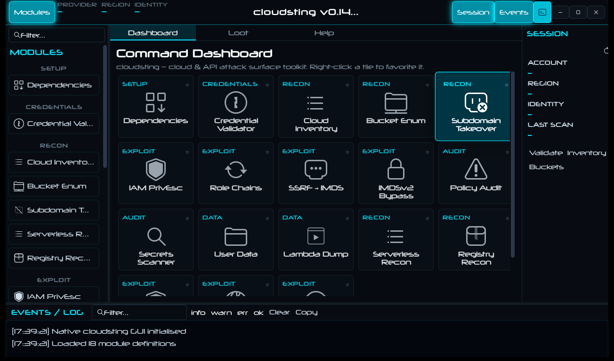
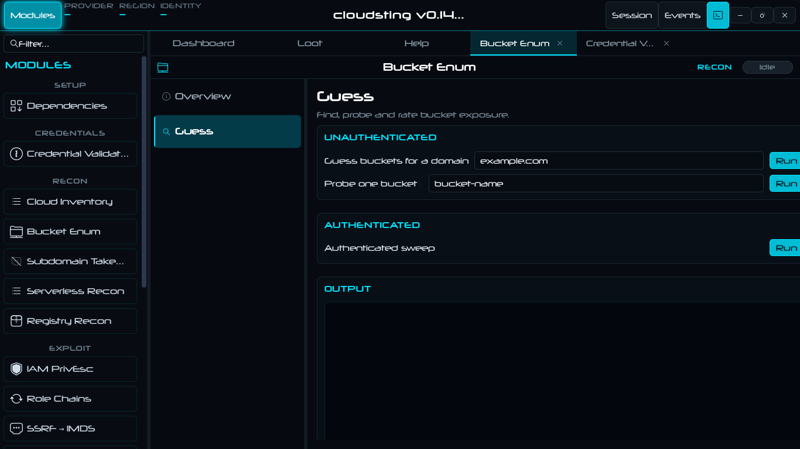

# cloudsting

A GTK4 cloud and API attack-surface toolkit for Linux, with a full CLI behind
it. Shell modules covering cloud credentials, asset inventory, storage exposure,
IAM privilege escalation, instance metadata, containers, Kubernetes and the
REST/GraphQL surfaces that sit in front of them.



Every module is a standalone script. The GUI is a view over them, not a
container — nothing is locked behind the interface.

> **Early development.** Twenty-three of the eighty-four planned modules exist.
> Modules that need provider credentials report what they are missing rather
> than pretending to succeed, and every module ships a `--selftest` that runs
> offline.

---

## Why this exists

Cloud attack tooling is split by provider and by verb. `prowler` audits AWS,
`scoutsuite` sweeps multi-cloud, `nuclei` fuzzes the web layer, `kube-hunter`
looks at clusters, and `trufflehog` looks for keys. Each has its own output
shape, its own idea of what "found nothing" means, and none of them agree on
what a finding is.

This tree is wide on purpose: one desk, one launcher, one place where a credential
sweep, a bucket exposure probe, an IAM escalation path and a Lambda dump all land
in the same TSV.

The other thing it does differently: **most tools tell you they worked.** This
one is built to tell you when they didn't. Every module has a `--selftest`, the
credential-gated ones name the tool or the credential they are missing instead of
returning an empty result, and a module that cannot do its job exits non-zero
rather than reporting success.

**No module has an approval gate.** Nothing refuses because a flag or an
environment variable was not set first. There is no `--i-have-authorisation`
and no `ARMED` variable to remember.

---

## How to run it

Any module runs directly, with no launcher and no installation:

```bash
./modules/00_deps.sh --preflight              # what this box has, one page
./modules/01_cred_validate.sh --detect        # what kind of credential is this
./modules/03_bucket_enum.sh --domain example.com
./modules/05_iam_privesc.sh --list            # the technique knowledge base
./modules/07_policy_audit.sh --audit policy.json
./modules/15_container_escape.sh --all        # escape primitives in this container
```

Every module also has `--selftest`, `--status-tsv`, `--menu` and `--help`:

```bash
for m in modules/*.sh; do printf '%s: ' "$m"; bash "$m" --selftest | tail -1; done
```

### The GUI

```bash
cd native
meson setup build
ninja -C build
./build/cloudsting
```

`meson` and `ninja` are only needed for the GUI. The modules are plain bash and
run without them.

### Dependencies

**Required:** `bash` 4.2+, `curl`, `jq`, `python3`, `openssl`, `git`.

```bash
# Debian / Ubuntu
sudo apt install bash curl jq python3 openssl git

# Arch
sudo pacman -S bash curl jq python3 openssl git
```

**Optional, used by specific modules:** the provider CLIs (`aws`, `gcloud`, `az`,
`doctl`, `oci`), the Kubernetes set (`kubectl`, `helm`), container tooling
(`docker`, `podman`, `trivy`), API and exploit tools (`nuclei`, `ffuf`, `httpie`,
`grpcurl`, `kiterunner`, `arjun`), audits (`scoutsuite`, `prowler`,
`kube-hunter`, `peirates`) and secret scanners (`trufflehog`, `gitleaks`).

`00_deps` reports what is present and what is missing, and distinguishes a tool
that is installed from a cloud that is actually authenticated:

```bash
./modules/00_deps.sh --status-tsv     # tool status, one row per tool
./modules/00_deps.sh --preflight      # one page: everything a first run needs
./modules/00_deps.sh --install-missing
```

| Verb | What it does |
|---|---|
| `--status-tsv` | One row per tool: `name`, `state`, `version` |
| `--preflight` | One page: build tools, cloud CLIs, authenticated providers, regions |
| `--distro-info` | Detected distribution and package manager |
| `install <package>` | Install one package through the detected package manager (pkexec) |
| `--install-missing` | Install every missing critical tool |
| `--install-all` | Install missing critical tools plus the optional set |
| `--install-pipx`, `--install-git` | Install one tool from its upstream source |

### The interface

The GUI opens on a **Dashboard** — every module as a card, grouped by the
category the module declares. Click a card and the module opens in its own tab.
Three tabs are permanent: **Dashboard**, **Loot** and **Help**. The module drawer
on the left lists every module by category; `Ctrl+T` opens a raw terminal inside
the app.



A module tab has its own submenu of pages, and **every verb the module documents
has a control on one of them**:

| Page kind | What it holds |
|---|---|
| **Overview** | Module identity, the script path, live `--status-tsv`, and a self-test button |
| **Action pages** | The module's verbs as cards, grouped by what they do — Probe / Sweep / Reference, Discover / Trace, Enumerate / Function |
| **Output** | Each action page owns its own output pane, colourised by severity |

Verbs are never rendered as CLI text: a button says what the job is ("Guess
buckets for a domain"), and the field next to it says what it wants
(`example.com`, `bucket-name`, `namespace secret`). Verbs that need root are
marked and run through `pkexec`, so the password prompt happens per action rather
than once at startup.

The bottom dock is **Events / Log**: every command, its start, its exit state and
a filter by severity.

---

## Modules

Twenty-three modules, grouped by the categories the application itself uses, so this
list and the Dashboard cannot drift apart.

### System

| Module | Description | Selftest |
|---|---|---|
| `00_deps` | Dependency manager: what is installed, what is missing, what is authenticated | 41 checks |

### Credentials and inventory

| Module | Description | Selftest |
|---|---|---|
| `01_cred_validate` | Detect a credential's provider from its shape, validate the format offline, then probe it live where that is possible | 19 checks |
| `02_inventory` | Enumerate reachable assets per provider, three-state per provider | 11 checks |

### Recon

| Module | Description | Selftest |
|---|---|---|
| `03_bucket_enum` | Guess bucket names for a domain, probe one bucket unauthenticated, or sweep an authenticated account | 11 checks |
| `04_takeover` | Subdomain takeover: fingerprint the body, classify the dangling CNAME, name the claimable service | 10 checks |
| `13_serverless_recon` | Serverless functions across AWS, GCP and Azure: list, environment, URLs, invoke | 8 checks |
| `14_registry_recon` | Container registries — ECR, GAR, ACR and Docker Hub OSINT | 8 checks |
| `18_cloud_dns` | Hosted zones across Route 53, Cloud DNS and Azure DNS; record dumps; dead-CNAME audit; zone transfers | 21 checks |
| `19_vpc_map` | Virtual networks, subnets, route tables and gateways, with an exposure read on the result | 19 checks |

### Exploit

| Module | Description | Selftest |
|---|---|---|
| `05_iam_privesc` | AWS IAM privilege-escalation mapper with a 20-technique knowledge base | 11 checks |
| `06_role_chains` | Role trust analyser and `sts:AssumeRole` chain tracer | 7 checks |
| `09_ssrf_imds` | SSRF into instance metadata: probe a URL, sweep every known endpoint | 11 checks |
| `10_imdsv2_bypass` | The techniques that still reach metadata on IMDSv2-only hosts | 10 checks |
| `15_container_escape` | Escape primitives in the current container: capabilities, mounts, namespaces, cgroups, docker socket | 9 checks |
| `16_k8s_attack_surface` | Cluster, workload and RBAC enumeration across EKS, GKE and AKS | 6 checks |
| `17_k8s_secrets` | Secret extraction, decoding, service-account tokens and RBAC abuse paths | 8 checks |

### Audit

| Module | Description | Selftest |
|---|---|---|
| `07_policy_audit` | IAM policy auditor: wildcards, NotAction/NotResource holes, privilege-bearing grants | 12 checks |
| `08_secrets_scan` | Sixteen signature families across a filesystem, a file or a stream | 12 checks |
| `20_sg_audit` | World-open firewall rules graded by the port class behind them | 36 checks |

### Data

| Module | Description | Selftest |
|---|---|---|
| `11_user_data` | EC2 user-data and instance identity documents, then a secret scan over what came back | 8 checks |
| `12_lambda_dump` | Lambda enumeration, configuration dump, code download, environment extraction | 6 checks |
| `21_db_exposure` | Managed databases: public reachability, missing backups/encryption, and a one-endpoint TCP probe | 34 checks |
| `22_audit_evasion` | Audit-trail coverage: which logging controls are off, and what each missing one hides | 27 checks |

### Verb reference

Each module's own `--help` is the authority; this is the map.

```
00_deps              --status-tsv --preflight --distro-info install --install-missing
                     --install-all --install-pipx --install-git --selftest
01_cred_validate     --detect --validate <credential> --list-formats --status-tsv
02_inventory         --run --regions --status-tsv
03_bucket_enum       --enum --perm <bucket> --domain <domain> --status-tsv
04_takeover          --scan <domain> --check <subdomain> --list --status-tsv
05_iam_privesc       --map --explain <technique> --list --check <action> --status-tsv
06_role_chains       --scan --chain <role> --whoami --list --status-tsv
07_policy_audit      --audit [file] --check <keyword> --explain <rule> --list --status-tsv
08_secrets_scan      --scan <path> --detect <value> --list --status-tsv
09_ssrf_imds         --probe <url> --tunnel --check <url> --list --status-tsv
10_imdsv2_bypass     --headers --list --ssrf <url> --exec <url> --check <url> --status-tsv
11_user_data         --dump --extract --keys --list --status-tsv
12_lambda_dump       --list --dump <fn> --download <fn> --env <fn> --urls --status-tsv
13_serverless_recon  --list --env <fn> --urls --invoke <fn> --all --status-tsv
14_registry_recon    --scan --list <repo> --images <repo> --tags <repo> --pull <repo:tag>
                     --dhl <namespace> --status-tsv
15_container_escape  --check --mounts --proc --cgroup --host --all --list --status-tsv
16_k8s_attack_surface --clusters --nodes --pods --rbac --secrets --all --list --status-tsv
17_k8s_secrets       --extract --decode <ns> <secret> --sa-tokens --rbac-abuse --all
                     --list --status-tsv
18_cloud_dns         --zones --records <zone> --resolve <name> [type] --dangling <zone>
                     --axfr <zone> --all --list --status-tsv
19_vpc_map           --vpcs --subnets --routes --gateways --map --list --status-tsv
20_sg_audit          --rules --audit --explain <port> --list --status-tsv
21_db_exposure       --instances --public --probe <host> [port] --engines --status-tsv
22_audit_evasion     --posture --blind --explain <check> --list --status-tsv
```

### Not built yet

Sixty-one modules are planned and unbuilt. They are listed here so the gap is
visible rather than implied:

| Range | Planned |
|---|---|
| 23–30 | Persistence, cross-account trust, snapshot theft, event/webhook abuse, metadata DNS rebinding, CI/CD attack, WAF bypass, edge exploitation |
| 31–40 | Vault extraction, provider API fuzzing, mail/SES abuse, console hijack, fleet sync, cryptojacking, backup ransom, cloud AD, tenant OSINT, canary hunting |
| 41–60 | API discovery, OpenAPI and GraphQL mapping, JWT and OAuth abuse, API-key harvesting, auth bypass, BOLA/BFLA, mass assignment, HPP, rate-limit abuse, injection, SSRF, webhooks, gRPC, WebSocket, SSE, request smuggling, response leaks, CORS, versioning, pagination |
| 61–78 | Upload abuse, deserialization, webhook signatures, session and refresh abuse, GraphQL DoS, binary fuzzing, spec diffing, business logic, race conditions, API DNS rebinding, LLM endpoints, key rotation, debug endpoints, mobile backends, replay |
| 79–84 | API-gateway recon, serverless URLs, IAM-derived API keys, event injection, log injection, token forging |

---

### How to audit it yourself

```bash
# every module, offline
for m in modules/*.sh; do printf '%-32s ' "$m"; bash "$m" --selftest | tail -1; done

# what each module thinks its own state is
for m in modules/*.sh; do bash "$m" --status-tsv; done

# what the box can actually reach
./modules/00_deps.sh --preflight
```

---

## How it is put together

The GUI is a view over the scripts in `modules/`. Nothing is locked behind it:

```bash
./modules/03_bucket_enum.sh --domain example.com
./modules/05_iam_privesc.sh --explain PassRole
./modules/17_k8s_secrets.sh --extract
```

Each module is a self-locating script: it resolves its own path, so it runs from
any directory and from any symlink, and it never depends on the caller's
environment. The modules whose selftest has to reach a parser directly are safe to
`source`: `CLOUDSTING_SOURCE_ONLY=1` makes the file define its functions and
return before dispatching, which is how those selftests test the parser instead
of the dispatch path.

A module is a small state machine with the same shape everywhere:

```
lib header      self-location, HOME reset, tmp/, loot/, state/ creation, run id
knowledge base  the tables the module reasons over (techniques, signatures, endpoints)
collectors      one function per provider or per check, each emitting rows
verbs           --run / --check / --probe / --scan / --map, each honest about absence
selftest        chk() assertions against shims and fixtures
dispatch        --status-tsv, --menu, --selftest, --help
```

### Conventions
Read TSV with `awk -F'\t'`, never `grep '\t'`: POSIX grep treats `\t` as a
literal `t`, so `grep -c '^aws\tec2'` silently matches nothing. And because tab
is an IFS whitespace character, `IFS=$'\t' read -r a b c` collapses runs of
empty fields — emit an explicit `-` placeholder for "no value" and normalise it
after reading, or every row with a hole in it shifts.

Every module follows the same contract, and the rules exist because ignoring them
produced a real bug at least once:

- **TSV out on stdout, one row per finding.** Diagnostics go to stderr, so a
  pipeline stays clean.
- **Three states, never collapsed.** `tool-missing` (no CLI on this box),
  `creds-missing` (CLI present, no credentials), `creds-present` (both). A module
  with no AWS CLI does not report "no buckets" — it reports that it could not
  look.
- **Distinct exit codes:** `0` success, `1` refused or nothing found, `2` usage.
- **`chk()`-based selftests with known answers**, not self-consistent ones: the
  expectation is written next to the assertion, and a parser that changes shape
  fails the test.
- **`awk -F'\t'` for row assertions, never `grep '\t'`.** POSIX grep treats `\t`
  as the letter `t`, which silently matched nothing and cost a day of debugging
  in module 02.
- **No approval gates and no armed variables.** A module either has what it needs
  or it says what it is missing.

---

## Directories

The toolkit creates `tmp/`, `loot/` and `state/` on first run. Nothing needs to
pre-exist.

**`loot/` is where results land** — one subdirectory per module, one run-record
per invocation:

```
loot/cred_validate/     result-<run>.tsv, raw.last (mode 600)
loot/bucket_enum/       result-<run>.tsv, perm-<run>.tsv
loot/takeover/          result-<run>.tsv
loot/iam_privesc/       result-<run>.tsv
loot/k8s_secrets/       ...
```

Everything in `loot/` came off a target and is **not redacted**. Credential
modules record a SHA-1 prefix rather than the secret itself, but the raw value is
in `raw.last` when a module had to hold it. Treat a copy of `loot/` the way you
would treat the credential it came from. Do not commit it, sync it, or email it.

**`state/` is what the GUI remembers** — window geometry, favourites, recent
modules, open tabs, and each module's own working data (`state/inventory.json`,
`state/bucket_words.cache`, …). Delete a file and that preference resets to its
default; the toolkit writes it again on the next change.

**`data/` holds reference data** the modules reason over, such as the subdomain
takeover wordlist. It is text, versioned, and small enough to diff.

---

## Troubleshooting

**"The module says OK but nothing happened."**
The failure worth reporting. Say which module, which verb, what you expected, and
what the target actually did.

**"It reports `creds-missing` for a provider I am logged into."**
Check what the module looks for: `~/.aws/credentials` or `AWS_ACCESS_KEY_ID` for
AWS, `gcloud auth list` for GCP, `~/.azure/azureProfile.json` for Azure,
`doctl auth list` for DigitalOcean. A module running under a different `HOME`
sees a different credential store — the modules reset `HOME` to their own tree by
design, and `00_deps --preflight` prints the state it sees.

**A selftest fails after a change.**
Run it before anything else:

```bash
./modules/03_bucket_enum.sh --selftest
```

The checks name what broke. If a check fails only when the module is run as a
script but passes when sourced, the bug is in the dispatch, not the parser.

**The GUI shows a module as "not registered".**
That module has a script but no entry in the GUI's module table. The page says so
instead of showing an empty tab.

---

## Contributing

One module per concern, in `modules/NN_name.sh`, following the contract above: a
`--selftest` with known answers, three-state provider reporting, TSV out, and a
`--status-tsv` that tells the truth about what the module could not see.

Two rules above the rest: **a module must never report success it did not
achieve,** and **a verb that exists must have a control on the module's page.**

## Credits

Modelled on the shape of [wifisting](https://github.com/yslxotwod/wifisting) and
[IMSIsting](https://github.com/yslxotwod/IMSIsting): same module contract, same
honesty rules, same dashboard-as-a-view-of-the-scripts design.

Built with GTK4 and VTE.
